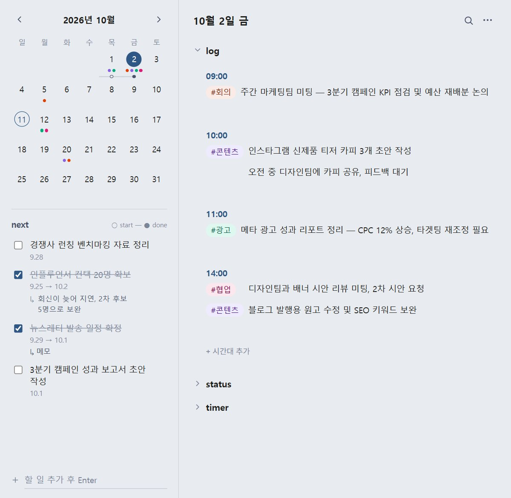
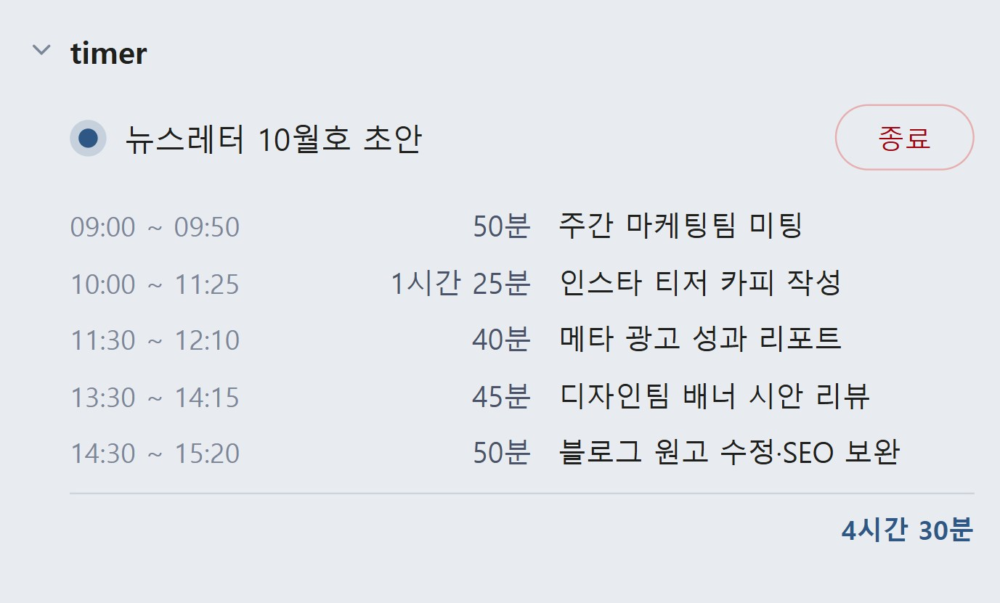

# Daylog

시간대별 업무 로그 + 태그 + 할 일(next) + 기분/집중도 기록을 한 화면에서 처리하는 개인용 데스크탑 앱입니다.
모든 기록은 사람이 읽을 수 있는 마크다운 파일로 저장됩니다.



> 위 화면은 마케팅 직군 사용을 가정한 예시 데이터입니다.

## 주요 기능

- **달력 + 시간대별 로그**: 선택한 날짜에 시간대(`09:00`, `14:00` ...)를 추가하고, 그 아래 자유 텍스트로 기록
- **예정 입력**: 오늘 이후 날짜의 로그 입력줄 오른쪽(마우스를 올리면 나타남)에 있는 `예정`을 켜고 입력하면 그 항목 앞에 ◇ 표시가 붙고 아직 지나지 않은 날짜는 달력에도 ◇로 표시됨. 날짜가 지나면 표시는 사라지고 일반 기록(태그 색 점)이 됨
- **반복 일정**: 달력 아래 `◇ 반복 일정`에서 매일·평일·매주·격주·매달(N개월마다 몇 일)·한 번만 규칙을 등록. 앞으로 올 회차는 달력에 ◇로 보이고, 기록 시점은 규칙마다 `당일`(그 날짜 로그) 또는 `월초`(해당 월 1일 로그에 "(25일)"처럼 날짜를 붙여 기록, 매달 규칙의 기본값) 중에서 고르며, 앱을 꺼 둔 날 것은 다음에 켤 때 채움. 달력의 ◇를 눌러 그 회차만 다른 날짜로 옮길 수 있고 다른 달은 그대로 유지됨
- **인라인 태그 + 태그 검색**: 텍스트 중 `#태그`를 쓰면 자동으로 색이 입혀진 pill로 표시되고, 같은 태그는 재입력 시 자동완성 제안. pill을 클릭하면 그 태그가 들어간 기록을 주/월 단위로 모아서 볼 수 있음
- **검색**: 헤더의 돋보기 또는 `Ctrl+F`로 기록 본문과 할 일을 한 번에 검색(기본 전체 기간, 주/월로 좁히기 가능). 검색창을 비워두면 쓴 태그가 칩으로 떠서 눌러 바로 볼 수 있고, `#태그`로 입력해도 돼요. 일치한 글자는 강조되고 날짜를 누르면 그 날로 이동
- **next (할 일) 목록**: 사이드바에서 간단한 체크리스트 관리, 달력에 시작일~완료일이 바(bar)로 표시. 항목 글자를 클릭하면 그 자리에서 수정하고, 시작일·완료일은 날짜를 클릭해 달력 선택창으로 바꿀 수 있음
- **next 메모**: 완료할 때 "왜 늦었는지" 같은 메모를 원하면 남길 수 있고(`↳`, 건너뛰기 가능), 나중에 추가·수정도 가능하며 검색에도 잡힘. 평소에는 `↳ 메모`로 접혀 있다가 클릭하면 펼쳐지고, `↳`나 `접기`로 다시 접음
- **status (focus / mood)**: 하루 단위로 집중도/기분을 bad·not bad·good 3단계로 기록
- **timer**: 기본으로 접혀 있는 `timer` 섹션에서 이름을 쓰고 `시작`/`종료`를 누르면 시작~종료 시각과 걸린 시간이 날짜별로 쌓이고 하단에 합계가 표시됨. 진행 중에는 이름만 보이고 경과 시간은 표시하지 않으며, 로그와 별도 파일에 저장됨. 기록의 이름·시각은 클릭해서 고치고, 마우스를 올리면 나오는 ×로 삭제

  

- **월 단위 내보내기**: 메뉴에서 `.md` 파일로 한 달치 기록을 내보내기
- **입력 단축**: 어느 입력칸에서든 `->`는 `→`, `ㄴ>`는 `↳`(하위 항목 표시)로 자동 변환되고, 바로 `Ctrl+Z`로 되돌릴 수 있음
- 저장은 자동(디바운스)이며 `Ctrl+S`로 즉시 저장도 가능

## 데이터 저장 방식

모든 데이터는 `~/worklog/` 폴더 아래 마크다운 파일로 저장됩니다. 외부 서버나 계정 없이 로컬에만 남고,
Dropbox/OneDrive 같은 동기화 폴더에 두면 그대로 백업·동기화도 됩니다.

```
~/worklog/
  2026-10-02.md   # 하루치 로그 (## log, ## status 섹션)
  next.md         # 할 일 목록
  tag_colors.json # 태그별 색상 매핑
  recurring.json  # 반복 일정 규칙 (회차 이동·기록 완료 정보 포함)
  timer.md        # timer 기록 (로그와 별도)
  timer_running.json # 진행 중인 timer (앱을 껐다 켜도 유지)
```

## 실행 환경

- Windows 전용입니다 (타이틀바 색상 테마 적용에 Windows DWM API를 사용합니다).
- Python 3.x

## 설치 및 실행

```bash
git clone <this-repo-url>
cd worklog-app
python -m venv venv
venv\Scripts\activate
pip install -r requirements.txt
python main.py
```

콘솔 창 없이 백그라운드로 띄우고 싶다면 `worklog.vbs`를 더블클릭하세요.

## 기술 스택

- [pywebview](https://pywebview.flowrl.com/) (Python ↔ OS 네이티브 창)
- 프론트엔드는 순수 HTML / CSS / JavaScript (프레임워크 없음). 실행할 때 `web/`의 `index.html`·`style.css`·`app.js`를 하나로 합쳐 창에 직접 넣으므로 로컬 서버를 따로 띄우지 않음
- 데이터 처리·저장은 `main.py`(Python), 화면은 `web/` 폴더

## 라이선스

[MIT](LICENSE)
